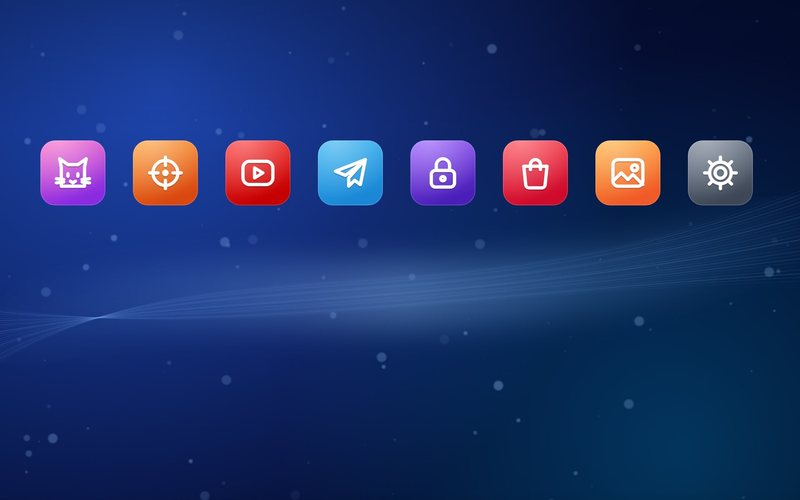

# MARKIZ PS5

Оформление компьютера и планшета в стиле консоли: синие живые обои, главный экран с играми, карточки и нижняя панель. Всё рисуется скриптами на Python.

> Фанатский проект. Не связан с Sony Interactive Entertainment и не одобрен ею. «PlayStation» и «PS5» — товарные знаки Sony; их логотипов, шрифтов и звуков здесь нет, вся графика и звуки нарисованы и сгенерированы с нуля.



## Что внутри

**`tablet/` — скрипты, которые рисуют оформление**

| Скрипт | Что делает |
|---|---|
| `make_wall.py` | Обои «MARKIZ NIGHT»: ночной неоновый город и кот Маркиз |
| `make_theme.py` | Неоновые иконки и тема Huawei (`.hwt`) |
| `make_ps.py` | Синие обои с волнами и цветные плитки-иконки |
| `make_iconpack.py` | Пакет иконок (APK) для Lawnchair, Nova и других лаунчеров |
| `make_pc_wall.py` | Синие обои под экран компьютера 2560x1440 |
| `make_pc_ps.py` | Иконки папок и первая версия плиток для Rainmeter |
| `make_pc_home.py` | Главный экран для Rainmeter: ряд игр, фон игры, кнопка «Играть», карточки (система, погода, диски, MARKIZ LAND, Steam, время в играх, звук и питание), заставка |
| `make_pc_dock.py` | Нижняя панель: «Домой», программы, звук, сеть, уведомления, время, питание |
| `make_cursor.py` | Курсор: белая стрелка с синей обводкой |

**`wallpaper_engine/markiz_ps5/`** — живые обои для Wallpaper Engine: синий фон с волнами и огоньками.

**`windows/`** — настройки Windows:
- `set_scale.ps1` меняет масштаб экрана (0 = 100 %, 1 = 125 %, 2 = 150 %);
- `start_button_styler.txt` — настройки мода Windhawk, чтобы поставить свою картинку на кнопку «Пуск»;
- `ВЕРНУТЬ_КАК_БЫЛО.ps1` — пример отката автора: он восстанавливает его собственные бэкапы, у тебя их не будет. Как убрать оформление у себя — см. ниже.

**`tablet/extract_icons.ps1`** — достаёт большие иконки программ для плиток и нижней панели.

## Установка на компьютер (Windows 10/11)

### 1. Поставь программы

| Программа | Зачем | Где взять |
|---|---|---|
| **Python 3.12+** | запускать скрипты | python.org (при установке отметь «Add Python to PATH») |
| **Google Chrome** | скрипты рисуют картинки через Chrome без окна | google.com/chrome |
| **Rainmeter** | главный экран, карточки, нижняя панель | rainmeter.net |
| Wallpaper Engine *(по желанию)* | живые обои | Steam, платный |
| TranslucentTB *(по желанию)* | прозрачная панель задач | Microsoft Store, бесплатно |
| Windhawk *(по желанию)* | своя картинка на кнопке «Пуск» | windhawk.net |

Потом открой PowerShell и поставь библиотеки:

```
pip install pillow cryptography
```

### 2. Скачай проект

На странице репозитория нажми **Code → Download ZIP** и распакуй, например, в `Документы\markiz-ps5`. Дальше все команды запускай из этой папки (в Проводнике: правой кнопкой по папке → «Открыть в терминале»).

### 3. Настрой под себя

Открой `tablet\make_pc_home.py` в Блокноте и поправь:

- **`W, H = 2560, 1440`** — разрешение твоего экрана (например, `1920, 1080`). То же в `make_pc_wall.py` и `SCREEN_W, SCREEN_H` в `make_pc_dock.py`.
- **`GAMES`** — твои игры. Для игры из Steam нужен её номер (AppID — число в адресе игры в магазине Steam), обложка и фон возьмутся из Steam сами. Для остальных — путь к `.exe` и цвет плитки.
- **`MEDIA`** — программы на вкладке «Медиа».
- **Город погоды** — найди `wttr.in/Nizhny+Novgorod` и `Нижний Новгород` и замени на свой город.

В `tablet\make_pc_dock.py` в списке **`APPS`** — программы нижней панели. Их AppID можно узнать командой `Get-StartApps` в PowerShell.

### 4. Достань иконки программ

Для игр не из Steam и для нижней панели нужны иконки. Пример (поменяй на свои программы, имена слева должны совпадать с ключами в `GAMES` и `APPS`):

```
powershell -ExecutionPolicy Bypass -File tablet\extract_icons.ps1 -Out tablet\ps_build\exeicons -Items @{ steam='C:\Program Files (x86)\Steam\steam.exe' }
powershell -ExecutionPolicy Bypass -File tablet\extract_icons.ps1 -Out tablet\ps_build\dockicons -Items @{ chrome='shell:AppsFolder\Chrome'; explorer='shell:AppsFolder\Microsoft.Windows.Explorer' }
```

### 5. Сгенерируй оформление

Запускай по порядку:

```
python tablet\make_ps.py
python tablet\make_pc_wall.py
python tablet\make_pc_ps.py
python tablet\make_pc_home.py
python tablet\make_pc_dock.py
```

Скрипты положат готовый скин в `Документы\Rainmeter\Skins\MarkizPS`, а обои — в папку `tablet`.

### 6. Включи

1. **Обои:** правой кнопкой по `tablet\markiz_blue_pc.png` → «Сделать фоновым изображением рабочего стола».
   Живые обои: скопируй папку `wallpaper_engine\markiz_ps5` в `…\steamapps\common\wallpaper_engine\projects\myprojects\` и выбери «MARKIZ PS5» в Wallpaper Engine.
2. **Rainmeter:** правой кнопкой по значку Rainmeter в трее → **Manage** → **Refresh all**. Потом в списке `MarkizPS` загрузи по очереди `Hero\Hero.ini`, `Home\Home.ini`, `Dock\Dock.ini` и (по желанию) `Splash\Splash.ini`.
   - **Hero** и **Home**: координаты `0, 0`, **Position → On desktop**.
   - У **Hero** включи **Click through**, иначе он будет перехватывать мышку.
   - **Dock** поставь внизу по центру.
3. **Курсор** *(по желанию)*: `python tablet\make_cursor.py`, потом Панель управления → Мышь → Указатели → «Обзор…» и выбери файлы из `%LOCALAPPDATA%\MarkizCursors`.
4. **Кнопка «Пуск»** *(по желанию)*: см. `windows\start_button_styler.txt`.

### Как убрать

- В Rainmeter: правой кнопкой по скинам `MarkizPS` → **Unload skin**.
- Обои и курсор — вернуть в Параметры → Персонализация.
- Значок «Пуск» — выключить мод в Windhawk.

## Установка на Android-планшет (по желанию)

1. Поставь лаунчер с поддержкой пакетов иконок (Lawnchair, Nova и т. п.).
2. Нужны Android build-tools (`aapt2`, `zipalign`) и `android.jar` в `%USERPROFILE%\android-build`, плюс `adb`.
3. Подключи планшет по USB с включённой отладкой и сохрани список приложений:
   ```
   adb shell cmd package query-activities --brief -a android.intent.action.MAIN -c android.intent.category.LAUNCHER > tablet/components.txt
   ```
4. `python tablet\make_ps.py`, потом `python tablet\make_iconpack.py ps_build` — получится `MARKIZ_NIGHT_icons.apk`.
5. Установи APK (`adb install MARKIZ_NIGHT_icons.apk`), в настройках лаунчера выбери пакет иконок **MARKIZ NIGHT icons**, а обоями — `tablet\markiz_blue.png`.

Обложки игр берутся из кэша Steam на твоём компьютере, поэтому в репозитории их нет.

## Лицензия

MIT — см. [LICENSE](LICENSE).
